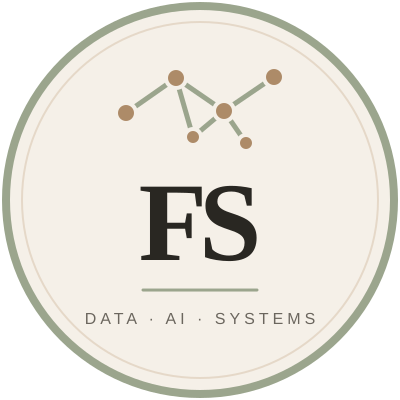

# Fatma Sena Kaya

**Management Information Systems · Computer Programming · AI & Data Science learner**

[GitHub](https://github.com/FSENAKAYA-code) · [LinkedIn](https://www.linkedin.com/in/sena-kaya-8634ba383/)

*Building thoughtful, data-driven solutions — one project at a time.*

---

## About me

I am a student building practical skills across software, data, and machine learning. My interdisciplinary background connects information systems and business analysis with computer programming and healthcare administration. I learn by building, documenting what I find, and improving each project through feedback.

## Education

- **Management Information Systems (English)** — Konya Food and Agriculture University · undergraduate student
- **Computer Programming** — Istanbul University, Open and Distance Education · student
- **Medical Documentation and Secretarial Studies** — Anadolu University, Open Education Faculty · graduate

## Areas of interest

Computer vision and CNNs · Turkish NLP and sentiment analysis · audio analysis · data visualization · APIs and responsible data collection · business intelligence · reproducible machine-learning workflows.

## Technologies

**Used in local portfolio project code:** Python, NumPy, pandas, scikit-learn, PyTorch, Transformers, SQLAlchemy, and Git. These projects are still being developed and reviewed; this list describes code present in local repositories, not professional mastery or production experience.

**Learning and exploring:** SQL, computer vision, NLP, audio processing, model evaluation, APIs, data visualization, and business intelligence dashboards.

## Selected projects

These projects are local works in progress and are not published on GitHub yet. Names and summaries below describe the repositories currently present in my portfolio workspace; results and public links will be added after review and publication.

| Project | Current focus | Status |
|---|---|---|
| `vision-matrix-cnn` | Image classification and CNN experiments | In progress |
| `acoustic-pulse-hmm` | Audio features and GMM/HMM experiments | In progress |
| `sitcom-sentiment` | Turkish sentiment baseline and sitcom-domain evaluation | In progress |
| `market-pulse-scraper` | Allowlisted public-page collection and price analysis | In progress |
| `health-mhrs-analytics` | Privacy-conscious appointment analytics | In progress |
| `fintech-algorithmic-trader` | Time-series analysis and risk metrics | In progress |
| `enterprise-erp-dashboard` | Business metrics and SQL-ready analytics | In progress |
| `anomaly-detector-fraud` | Imbalanced classification and anomaly evaluation | In progress |
| `neural-hybrid-pipeline` | Image and tabular feature fusion | In progress |
| `automated-ci-ml-ops` | Reproducible experiments, tests, and CI | In progress |

I aim to document data sources and licenses, prevent data leakage, use task-appropriate metrics, and report only results from experiments that have actually run.

## GitHub activity

The profile repositories are being prepared locally. Public repository links and activity summaries will become meaningful after the repositories are published. Any future statistics cards will rely on a third-party service and may be unavailable or delayed.

## Opportunities

I am eager to keep learning, improve my portfolio, collaborate, and apply for internships. I am also open to suitable, clearly scoped freelance projects involving data analysis, Python automation, dashboards, or beginner-friendly machine-learning work.

## Contact

- GitHub: [@FSENAKAYA-code](https://github.com/FSENAKAYA-code)
- LinkedIn: [Sena Kaya](https://www.linkedin.com/in/sena-kaya-8634ba383/)

*Curious by nature. Always learning.*

